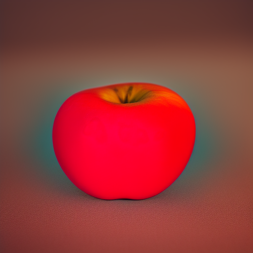

# Haruna Android multimotor — entrega

## Base preservada

- Branch: `feature/safetensors-sd15`; sem merge na principal.
- Base da integração Android inicial: `2497e3c41f9f7f7a4056123eac16ed6fd5c20acf`.
- Base desta expansão: `0c92681aee69999bd9ce04afd239165ddc5d2bc8`.
- Código do APK: `9dc7241e03ed43b1d62ade9bad173bbb990f07c0`.
- Referência Windows: `feature/windows-sdxl` em `21a2b857c969259c47e433efb765b1ccc62e3215`.
- Esta documentação posterior não muda o binário.

## Implementação real

O Android mantém a WebView, os seletores Android, o armazenamento privado e os
motores existentes. Não foi substituído pelo aplicativo Electron do Windows.
O SDK de imagem é o mesmo usado no Windows: stable-diffusion.cpp
`f5df5f8b84f139f1e80496902da90798a0d92896`, com GGML próprio
`135ce1e0e3f2b0693d3de93d4f6b5fa0a1947820`. A biblioteca JNI é independente,
com símbolos privados, compilação separada e dependências fixadas por SHA-256;
não troca o GGML usado pelo llama.cpp ou Whisper.

O roteamento identifica ZIPs MNN/Nezumi e checkpoints Safetensors completos
SD1.5/SDXL. O nome do arquivo não é prova de compatibilidade. SDXL exige a
assinatura estrutural CLIP-L 768 + CLIP-G 1280, atenção cruzada 2048, UNet de
quatro canais e VAE. A confirmação final acontece pelo carregador nativo.
Não aceita LoRA, SD2, componentes separados ou um GGUF de conversa como SDXL.
Checkpoints acima de 8 GiB são recusados. O modelo não está incluído no APK.

Importação valida o cabeçalho antes de copiar pesos, usa buffers limitados,
SHA-256, staging e conclusão atômica; não inicia inferência. A restauração
verifica integridade. Instalar não exige ter RAM para executar o modelo.
Seleção e preferências ficam no armazenamento já existente, sem migração ou
exclusão de conversas e dados do usuário.

O lease compartilhado impede concorrência entre imagens e GGUF: descarrega o
LLM antes de abrir o motor de imagem, bloqueia outro proprietário e libera
sessão/recursos ao terminar, cancelar ou falhar. Cancelamento é cooperativo;
um kernel ou carregamento nativo pode demorar para atingir uma fronteira
cancelável. Não há garantia de que o Android não encerre um processo por RAM.
O fluxo Android existente de recarga do GGUF foi preservado; não foi portado o
supervisor de processos do Electron.

A geração fica no chat, com progresso real, cancelamento, PNG privado e as ações
existentes de visualizar, salvar e compartilhar. Não há interface de conversa
paralela. Configurações técnicas continuam na seção de geração de imagens.

## SDXL / Illustrious / RIN

Perfil inicial: CPU, `params_backend=disk`, mmap, CFG sequencial, Flash Attention
no motor de imagem e VAE tiling. Resolução nativa 1024², 28 etapas, CFG 5,
clip skip 2, Euler/discrete. Resolução e etapas SDXL possuem preferências
separadas das configurações MNN/SD1.5 existentes. Opções 256/512 reduzem o PNG
final; o cálculo SDXL permanece 1024². Isso evita anunciar economia de
inferência inexistente. Perfil não prova qualidade ou compatibilidade do RIN.

Referência do autor: https://tensor.art/models/1040109127226907325
Os pesos RIN não foram fornecidos, redistribuídos nem executados. A versão
Windows também documenta que não os executou. O suporte implementado é ao
caminho SDXL/Illustrious completo; o checkpoint RIN específico ainda exige
validação física. Não foi demonstrado que ele cabe ou não cabe no Teclast.

Os controles de proporção retangular e tamanho personalizado do Windows não
foram portados; este fluxo Android mantém saídas quadradas 256/512/1024.

Vulkan/OpenCL não estão habilitados neste APK. Não há seletor fictício nem
promessa de offload. CPU é o caminho integrado e compilado nesta entrega.

## Evidência e testes

**Inferência real em host Linux, não no tablet:** checkpoint SD1.5 público
`v1-5-pruned-emaonly-fp16.safetensors`, 2.132.696.762 bytes, SHA-256
`e9476a13728cd75d8279f6ec8bad753a66a1957ca375a1464dc63b37db6e3916`.
Fonte: Comfy-Org/stable-diffusion-v1-5-archive, revisão
`9cfd069101959ca3828bf9c04a4419870832b74f`; CreativeML OpenRAIL-M.
Modelo não incorporado ao aplicativo.

JNI real gerou uma imagem coerente de maçã em 512², cinco etapas, seed 424242.
Geração: 296,44 s; pico RSS do processo: 3.784.548 KiB. SHA-256 do PNG:
`0b19a2d4c7aa9fb5707787db69c855568edd7d9665c4355149d5ed430bfb376a`.
Esses números não predizem tempo ou RAM do Android e não são evidência SDXL.

256² nativos produziram artefatos, inclusive com vinte etapas. A API C direta
reproduziu o resultado com e sem mmap/CFG batched. O fluxo SD1.5 passou a
calcular em 512² e reduzir o PNG quando solicitado 256². O padrão de saída
256² e cinco etapas foi preservado; modelos convencionais normalmente exigem
mais etapas para qualidade.

Cancelamento JNI real interrompeu a geração sem PNG; close repetido e reabertura
passaram. As bibliotecas MNN/Nezumi puderam coexistir com a biblioteca SD no host.

**Testes automáticos locais:** 24 testes JUnit passaram; controlador real com
Android e motores falsos passou instalação, seleção, persistência, troca,
exclusão de concorrência, falha, cancelamento, cleanup e roteamento SDXL,
incluindo preferências independentes 1024/28. São testes de integração do
controlador, não inferência dos motores falsos. JNI com API SD falsa passou
progresso e corrida cancel/free. UI em 360×800 e 800×1280 passou com bridge e
PNG de teste, preservando configurações, cartão e histórico.

## Build e instalação

Build ARM64 autorizado: https://github.com/doutor56-lab/Haruna/actions/runs/42144339412

**SUCCESS.** Kotlin, testes unitários, teste do controlador, teste JNI,
assembleDebug, verificação do APK e publicação das fontes passaram.

[Instalador: artefato contendo somente o APK](https://github.com/doutor56-lab/Haruna/actions/runs/42144339412/artifacts/13470712798)

[Fontes e relatório técnico do build](https://github.com/doutor56-lab/Haruna/actions/runs/42144339412/artifacts/13470508124)

APK: 58.375.189 bytes. SHA-256:
`eddfc069c25447f033eb42e3432676ef95f5c48173aee49fd49d9c628e866615`.
Arquivo baixado e hash conferido com o log do CI; ZIP de instalação contém
somente o APK. Bibliotecas ARM64 de GGUF, MNN/Nezumi, SD, Whisper e Sherpa
presentes. SD exporta apenas seus métodos JNI e não depende de GGML/Vulkan
externos. Apenas um workflow de build foi iniciado com a autorização desta
entrega; esta documentação usa `[skip ci]`.

APK: `Haruna-Multimotor-ARM64-debug.apk`. Instalação e artefato técnico separados.
Android mínimo 13/API33. Pacote existente: `com.proxyslabs.haruna.incremental`.
Se o Android recusar atualização por assinatura diferente, não desinstale para
contornar: isso pode apagar os dados locais. Preserve backup e use assinatura
compatível. Nenhum modelo é baixado automaticamente ou embutido no APK.

No tablet: instalar, abrir Configurações → Geração de imagens, importar o
checkpoint completo obtido legitimamente, selecionar e gerar pelo chat.
O primeiro teste confirma carregamento, progresso, PNG e uso de memória.
Não declarar pronto no Teclast até essa execução. STT/TTS, GGUF e MNN/Nezumi
foram preservados, mas não foram novamente testados em hardware nesta entrega.

## Arquivos desta expansão

- `.github/workflows/android-build.yml`
- `app/src/main/assets/haruna/image-models.js`
- `app/src/main/cpp/safetensors/safetensors_jni.cpp`
- `app/src/main/java/com/proxyslabs/haruna/image/ImageBridge.kt`
- `app/src/main/java/com/proxyslabs/haruna/image/ImageFiles.kt`
- `app/src/main/java/com/proxyslabs/haruna/image/ImagePackage.kt`
- `app/src/main/java/com/proxyslabs/haruna/image/SafetensorsArchitecture.kt`
- `app/src/main/java/com/proxyslabs/haruna/image/SafetensorsImageNative.kt`
- `app/src/main/java/com/proxyslabs/haruna/image/SafetensorsInspector.kt`
- `app/src/main/java/com/proxyslabs/haruna/image/SafetensorsPackage.kt`
- `app/src/main/java/com/proxyslabs/haruna/image/SafetensorsSession.kt`
- `app/src/test/java/com/proxyslabs/haruna/image/SafetensorsArchitectureTest.kt`
- `tests/image_controller_check.py`
- `docs/ANDROID_MULTIMOTOR.md`
- `docs/SAFETENSORS_SD15_ANDROID_INTEGRATION.md`
- `docs/ANDROID_MULTIMOTOR_RELATORIO.md` (documentação posterior ao build)

Evidência adicional: `docs/evidence/safetensors/SD15_HOST_512.png`, PNG real
do host, sem pesos do modelo ou conteúdo privado do usuário.
